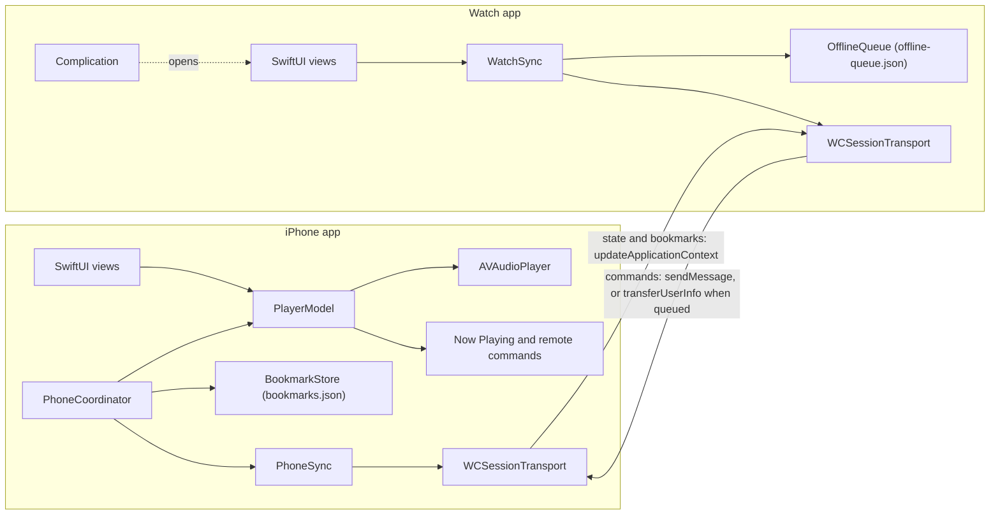

# WristCue

A podcast player for iPhone with an Apple Watch remote. The iPhone plays episodes. The Watch shows what's playing, controls playback, changes the volume with the Digital Crown, and saves a bookmark of the current moment with one tap, including while the iPhone is out of reach.

It's built to run entirely in the Simulator with a free Apple ID: no MusicKit, CloudKit, push notifications or paid-account capabilities. The four episodes are synthetic, generated with the macOS `say` command.

## Status

- [x] M1: `WristCueKit` models, versioned wire protocol, progress interpolation, offline queue, tests (110 tests at M5, 98.70% line coverage; see [docs/PERFORMANCE.md](docs/PERFORMANCE.md))
- [x] M2: iPhone playback and Now Playing (Lock Screen panel not drawn by the iOS 27.0 Simulator; app side verified, see docs/LEARNING.md)
- [x] M3: Watch Now Playing and WatchConnectivity (8 Simulator checks passed after a Swift 6 crash fix; see docs/LEARNING.md)
- [x] M4: Bookmarks and offline queue on both devices (10 Simulator checks passed, including queue survival across a Watch app relaunch)
- [ ] M5: Naive vs. optimized sync, measurements (kit measurements recorded; Simulator traffic, latency and CPU runs pending)
- [ ] M6: Accessibility, UI tests, complication (6 of 6 iPhone UI tests pass, including accessibility audits; Watch VoiceOver and complication checks pending)
- [ ] M7: Docs and CI (written; first CI run pending)

## Features

On the iPhone: an episode list, a player with a scrubber, skip back 15 and forward 30, volume, and a "Bookmark this moment" button, and a Bookmarks screen grouped by episode (tap to play from that moment, swipe to delete). Playback uses AVFoundation with a `.playback` / `.spokenAudio` audio session, so it continues in the background and handles interruptions and unplugged headphones. Lock Screen and Control Center controls come from `MPNowPlayingInfoCenter` and `MPRemoteCommandCenter`.

On the Watch: Now Playing with a progress bar computed locally, play/pause, skip back 15 and forward 30, Digital Crown volume, a large Bookmark button, the current episode's bookmarks (tap to jump), haptics for every action, and an offline queue saved to disk. A watch face complication opens the app.

Both: VoiceOver labels on every control, Dynamic Type, and a debug-only traffic panel used for the measurements.

## Architecture



The sync logic lives in `Packages/WristCueKit`, a Swift package with no UI and no WatchConnectivity import. `PhoneSync` and `WatchSync` talk to a `ConnectivityTransport` protocol. In the apps that's `WCSessionTransport` (in `Shared/`), and in tests it's `InMemoryTransport`, which follows the same delivery rules. So every sync decision is unit tested on a Mac without simulators.

| Data | Channel | Why |
|---|---|---|
| A tap on the Watch (play, skip, volume, bookmark) | `sendMessage` with a reply handler | Someone is waiting for the result, and the iPhone app is reachable. |
| iPhone playback state | `updateApplicationContext`, own slot | Only the newest state matters. The system keeps one value. |
| Current episode's bookmark list | `updateApplicationContext`, own slot | Same, and a state update never overwrites it. |
| Commands and bookmarks made while the iPhone was unreachable | `transferUserInfo` | Every item must arrive, in order, even if the Watch app quits. |

Other decisions, with the reasoning, are in [docs/LEARNING.md](docs/LEARNING.md): the Watch shows an optimistic guess after a tap and replaces it when the iPhone's state echoes the command's ID; commands carry UUIDs so a command that arrives twice runs once; the offline queue coalesces volume and play/pause, drops playback commands older than 30 seconds and never drops bookmarks; the crown sends one volume command after it rests for 300 ms; and the Watch redraws progress at most once a second, once a minute in always-on, and not at all when paused.

## Measurements

Everything in [docs/PERFORMANCE.md](docs/PERFORMANCE.md) comes from a run, with the command next to it. Recorded so far:

- `WristCueKit`: 110 tests, 0 failures, 98.70% line coverage (684 of 693 lines), from `xcodebuild test` and `xccov`.
- iPhone UI tests: 6 of 6 pass, including Xcode's accessibility audit on two screens.
- Payload sizes: a playback state is 246 bytes of JSON, commands 158 to 309 bytes, a bookmark list 103 bytes plus about 133 per bookmark.
- Traffic model (kit test, in-memory transport, one scripted minute): optimized sync sends 5 messages and 912 bytes, naive sync 83 messages and 17,708 bytes.

The Simulator measurements (traffic per minute, crown turn, command round trip median and p95, Watch CPU) have their methods written up and are added once run. Battery, Bluetooth latency and real-device CPU can't be measured in the Simulator and aren't claimed.

## Requirements

- Xcode 27 with the iOS and watchOS Simulator runtimes
- [XcodeGen](https://github.com/yonaskolb/XcodeGen) (`brew install xcodegen`)
- The macOS voice Samantha, for generating the audio (System Settings > Accessibility > Spoken Content > System Voice > Manage Voices)

No Apple Developer account. Everything is signed with "Sign to Run Locally".

## Run it

Generate the audio (`WristCue/Resources/Audio/*.m4a`), then the Xcode project (`WristCue.xcodeproj`, from `project.yml`):

```sh
scripts/make-audio.sh
xcodegen generate
```

The command blocks in this README have no inline `#` comments, because zsh, the default macOS shell, passes them to the command as arguments unless `interactivecomments` is set.

Pair an iPhone and an Apple Watch Simulator (Xcode > Window > Devices and Simulators, or `xcrun simctl pair`), boot both, then build and install. Build outside the repository when it lives in an iCloud-synced folder (Desktop or Documents): iCloud adds Finder attributes to new files, and `codesign` rejects an app bundle that has them ("resource fork, Finder information, or similar detritus not allowed").

Building the WristCue scheme also builds the Watch app it embeds.

```sh
B=~/Library/Developer/WristCueBuild
PHONE=$(xcrun simctl list devices booted | grep -m1 "iPhone" | grep -oE '[0-9A-F-]{36}')
WATCH=$(xcrun simctl list devices booted | grep -m1 "Apple Watch" | grep -oE '[0-9A-F-]{36}')

xcodebuild -project WristCue.xcodeproj -scheme WristCue \
  -destination "platform=iOS Simulator,id=$PHONE" -derivedDataPath $B build
xcrun simctl install $PHONE $B/Build/Products/Debug-iphonesimulator/WristCue.app
xcrun simctl install $WATCH $B/Build/Products/Debug-watchsimulator/WristCueWatch.app

xcrun simctl launch $PHONE info.satwik.wristcue
xcrun simctl launch $WATCH info.satwik.wristcue.watchkitapp
```

Open an episode on the iPhone, then use the Watch.

To run in naive sync mode for comparison, pass `-WristCueSyncMode naive` to both launches. Each app's debug traffic panel (under the iPhone player, and Diagnostics behind the gauge icon on the Watch) shows the active mode.

No sound from the Simulator? Choose your Mac's speakers in the Simulator's I/O > Audio Output menu. The Simulator can lose its output after AirPods connect or disconnect.

## Tests

Kit unit tests, from `Packages/WristCueKit`:

```sh
cd Packages/WristCueKit
xcodebuild test -scheme WristCueKit -destination 'platform=macOS' -enableCodeCoverage YES -resultBundlePath ../../build/WristCueKit.xcresult
xcrun xccov view --report --only-targets ../../build/WristCueKit.xcresult
```

`swift test` from the same directory works too, outside an iCloud-synced folder.

iPhone UI tests (XCUITest, including Xcode's accessibility audit), from the repository root:

```sh
xcodebuild test -project WristCue.xcodeproj -scheme WristCue \
  -destination "platform=iOS Simulator,id=$PHONE" -derivedDataPath $B
```

CI (`.github/workflows/ci.yml`) runs the kit tests with coverage and builds both apps and the UI test bundle on every push.

## Project layout

```
Packages/WristCueKit/     models, wire protocol, sync logic, storage, diagnostics, tests
Shared/                   WCSessionTransport and the debug traffic table, in both apps
WristCue/                 iPhone app: playback, Now Playing, screens
WristCueWatch/            Watch app: Now Playing, bookmarks, diagnostics, haptics
WristCueComplication/     watch face complication (WidgetKit)
WristCueUITests/          iPhone UI tests
scripts/                  audio generation, CPU measurement
docs/                     PERFORMANCE.md, LEARNING.md, RESUME_NOTES.md
project.yml               XcodeGen spec for WristCue.xcodeproj
```

## Screenshots

To capture with File > Save Screen in the Simulator, into `docs/screenshots/`:

1. iPhone episode list
2. iPhone player while playing
3. iPhone Bookmarks screen with bookmarks from both devices
4. Watch Now Playing while playing
5. Watch Now Playing with "1 waiting" while the iPhone app is stopped
6. Watch bookmarks list with one pending bookmark
7. Watch Diagnostics after a 40-command round-trip run
8. The complication on a watch face

## Known limitations

- The iOS 27.0 Simulator doesn't draw the Lock Screen or Control Center player for this app. A debug panel under the player shows what the app publishes to `MPNowPlayingInfoCenter` instead.
- The complication opens the app but shows no playback data, because that would need an App Group shared container, which wasn't verified under free signing.
- The Watch app has no UI tests. Its screens were checked by hand.
- All measurements come from Simulators on one Mac, which talk over local IPC rather than Bluetooth.

## License

MIT. See [LICENSE](LICENSE).
